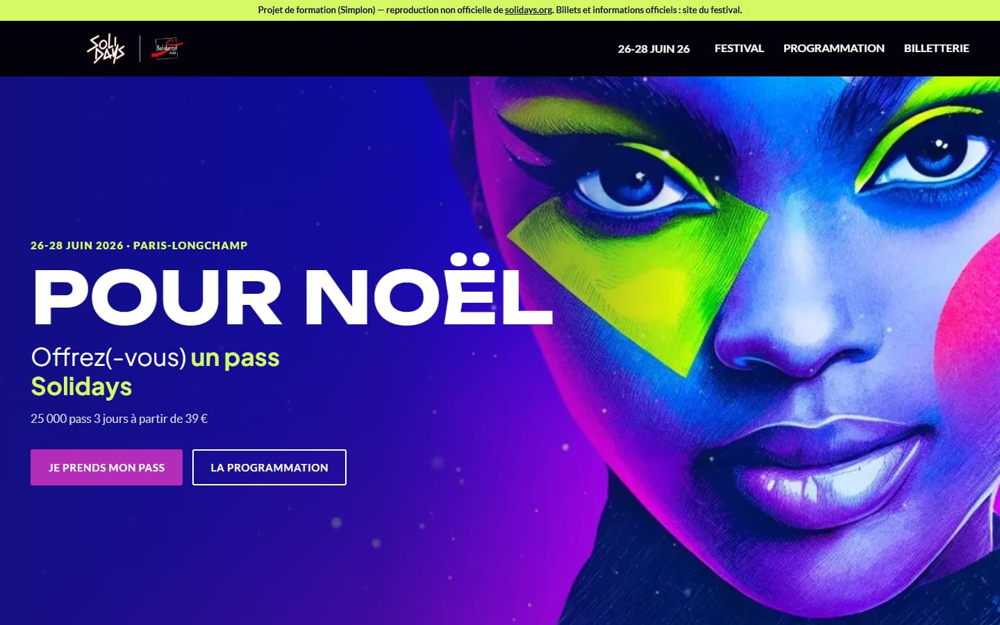
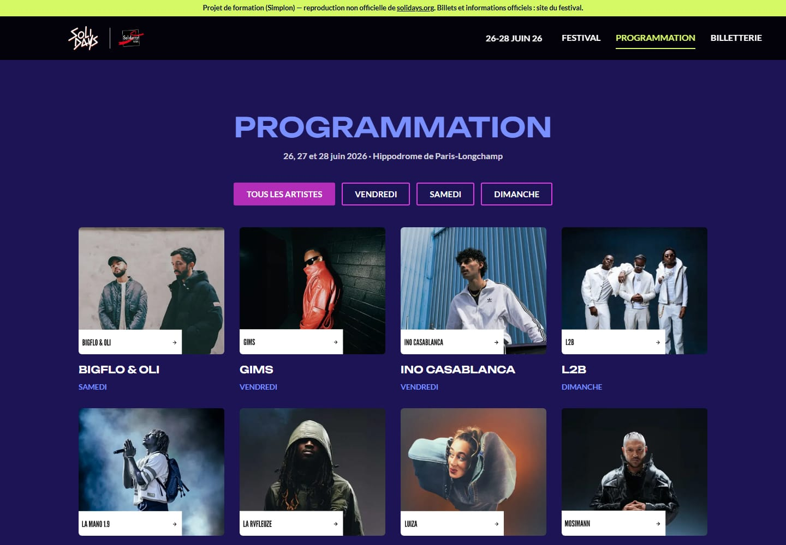
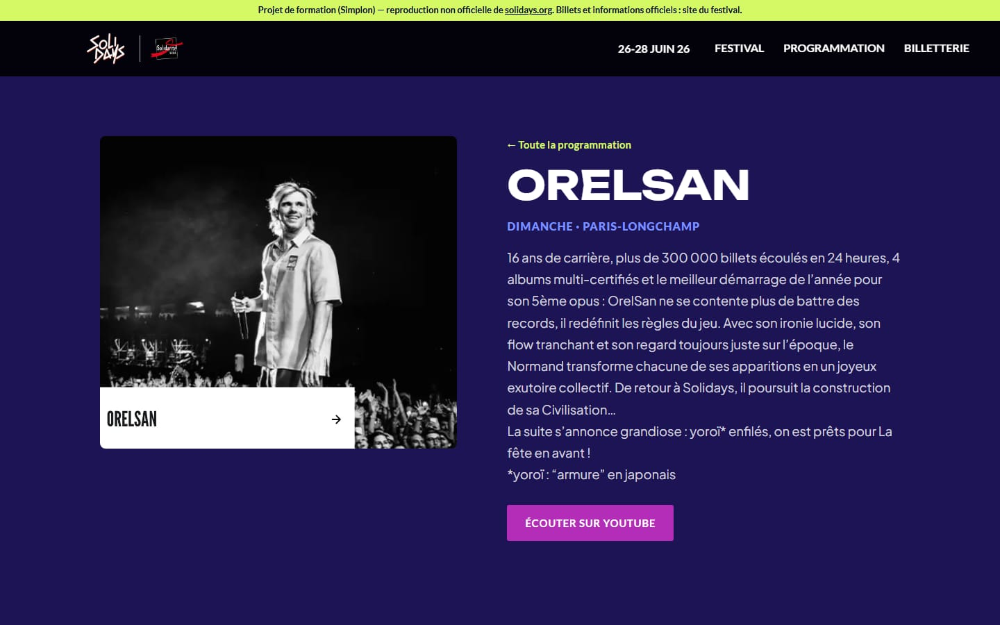
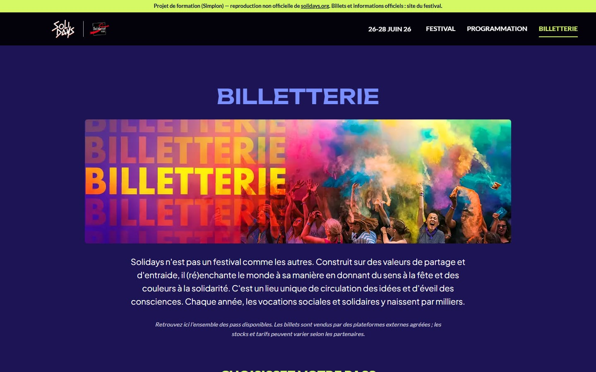
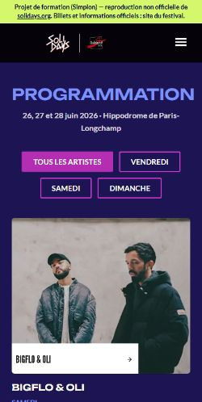

# Solidays App — clone du site du festival (projet de formation en équipe)

[](https://github.com/AwadAhmedDev/solidays_app/actions/workflows/ci.yml)


**▶ Démo en ligne : https://tasteful-lightcoral-yak-94.hostingersite.com**

Application web full stack réalisée en **équipe de 3 développeurs** pendant la formation Développeur web et web mobile chez **Simplon.co**. Le sujet, donné par les formateurs : **reproduire le site [solidays.org](https://www.solidays.org)** du festival Solidays, avec programmation, fiches artistes, billetterie et back-office.

> Projet pédagogique : reproduction non officielle, sans lien avec le festival Solidays ni avec l'association Solidarité Sida. Les marques, visuels et textes repris appartiennent à leurs auteurs. Le site affiche un bandeau « projet de formation » et n'est pas indexé par les moteurs de recherche.



## L'équipe

| | Développeur·se | Commits |
|---|---|---|
| 👤 | **Awad** — [@AwadAhmedDev](https://github.com/AwadAhmedDev) | 56 |
| 👤 | **Prativa** — [@prativa-k](https://github.com/prativa-k) | 46 |
| 👤 | **Manon** — [@manonjarzabeck](https://github.com/manonjarzabeck) | 30 |

Organisation :
- un seul dépôt, une branche par fonctionnalité ;
- **pull requests et revues de code** : plus de 50 fusions ;
- pages et composants répartis entre les membres ;
- modélisation Merise réalisée ensemble.

## Fonctionnalités

- **Accueil** fidèle au site d'origine :
  - hero ;
  - manifeste « Yes We Love » ;
  - bannière d'artistes interactive : la photo change au survol de chaque nom ;
  - choix des pass, « À la une » et rubriques du festival.
- **Programmation** : artistes chargés depuis l'API, filtrés par jour (vendredi, samedi, dimanche).
- **Fiches artistes** : description, jour du concert, lien YouTube.
- **Billetterie** (liens vers les vendeurs officiels) et page **Festival**.
- **Back-office sécurisé** :
  - connexion administrateur ;
  - ajout, modification et suppression d'artistes ;
  - upload d'image avec aperçu ;
  - confirmation avant suppression.
- Mentions légales, page 404, site entièrement adapté au mobile.

| Programmation | Fiche artiste |
|---|---|
|  |  |

| Billetterie | Mobile |
|---|---|
|  |   |

## Qualité

| Lighthouse (démo en ligne, 22/11/2026) | Performance | Accessibilité | Bonnes pratiques |
|---|---|---|---|
| Ordinateur | **100** | **100** | **100** |
| Mobile | **94** | **100** | **100** |

Le SEO n'apparaît pas : le site est volontairement en `noindex`, puisqu'il s'agit d'un clone.

- **24 tests automatisés**, lancés avec `node:test` :
  - unitaires : jeton de session (falsifié, expiré, mauvaise clé) et validation des données ;
  - intégration de l'API sur une vraie base MySQL : lecture, refus sans connexion, connexion, ajout, modification avec accents, suppression, faux fichier image.
- **ESLint** et **TypeScript strict** sur le front, le serveur et les tests.
- **`npm audit`** : 0 vulnérabilité ; **Dependabot** propose les mises à jour chaque semaine.

## CI / CD

```
push / pull request ──► GitHub Actions (CI)
                          ├─ npm ci
                          ├─ ESLint
                          ├─ TypeScript (front + serveur)
                          ├─ tests (unitaires + API sur MySQL 8.4)
                          ├─ build de production
                          └─ npm audit
push sur master ──────► Hostinger (CD) : build et redéploiement automatique (~30 s)
                          └─ GitHub Actions « smoke » : vérifie que la démo en ligne répond
                             et que l'écriture sans connexion est bien refusée
```

- **CI** : [`.github/workflows/ci.yml`](.github/workflows/ci.yml).
- **CD** : le déploiement automatique Git de Hostinger (Node 22, dossier `code`, point d'entrée `app.js`). Au premier démarrage, la base est initialisée à partir des scripts SQL de l'équipe.

## Stack technique

| Couche | Technologies |
|---|---|
| Front-end | React 19, TypeScript, Vite 7, React Router 7, CSS Modules, React Hook Form, Zod |
| Back-end | Node.js 22, Express 5, TypeScript (tsx) |
| Base de données | MySQL (tables `role`, `user`, `artist`) |
| Sécurité | Session admin par cookie httpOnly signé (HMAC), mots de passe argon2id, Helmet (CSP), validation serveur Zod, limite de tentatives de connexion |
| Fichiers | Upload Multer (5 Mo max), vérification du type réel avec `file-type` (JPG, PNG, WebP, AVIF) |
| Qualité | ESLint, TypeScript strict, tests `node:test`, GitHub Actions, Dependabot |
| Environnement | Docker Compose (MySQL 8.4 + Node 22) |

## Architecture

```
code/
├── server/
│   ├── core/          # configuration Express (sécurité, compression, service du site en production)
│   ├── router/        # routes REST (/api/artist, /api/auth)
│   ├── controller/    # traitement des requêtes
│   ├── repository/    # accès aux données MySQL
│   ├── service/       # pool MySQL, fichiers, sessions, initialisation de la base
│   └── validator/     # validation des données reçues
├── src/
│   ├── pages/         # accueil, programmation, artiste, billetterie, festival, admin
│   ├── components/    # navbar, hero, bannières, onglets de programmation, footer…
│   ├── services/      # appels à l'API
│   └── validators/    # validation des formulaires
├── test/              # tests unitaires et d'intégration
├── merise/            # MCD, MLD, MPD
└── mysql/             # scripts de création et de données de démonstration
```

### Modélisation des données (Merise)

| MCD | MLD | MPD |
|---|---|---|
|  |  |  |

## Lancer le projet en local

Prérequis : Docker et Docker Compose.

```bash
# 0. Créer le fichier d'environnement à partir du modèle
#    (remplir SESSION_SECRET : node -e "console.log(require('crypto').randomBytes(32).toString('hex'))")
cp code/.env.development.example code/.env.development

# 1. Démarrer MySQL et le conteneur Node
docker compose -f docker-compose.dev.yaml up -d

# 2. Créer la base et insérer les données
docker compose -f docker-compose.dev.yaml exec mysql sh -c "mysql -uroot -proot < solidays.dev.sql && mysql -uroot -proot < fichiers.dev.sql"

# 3. Lancer l'API
docker compose -f docker-compose.dev.yaml exec node sh -c "npm install && npm run server"

# 4. Dans un autre terminal, lancer le front (Vite relaie /api vers Express)
docker compose -f docker-compose.dev.yaml exec node sh -c "npm run dev -- --host"
```

Commandes utiles, dans `code/` :

| Commande | Rôle |
|---|---|
| `npm run lint` | ESLint |
| `npm run typecheck` | TypeScript (front + serveur + tests) |
| `npm test` | tests unitaires et API (nécessite MySQL : `MYSQL_HOST`, `MYSQL_USER`, `MYSQL_PASSWORD`) |
| `npm run build` | build de production dans `dist/` |
| `npm start` | serveur de production (Express sert le site et l'API) |

Le mot de passe du compte admin n'est pas dans le dépôt. En production, le compte est créé au premier démarrage à partir des variables `ADMIN_EMAIL` et `ADMIN_PASSWORD` (voir `code/.env.production.example`).
