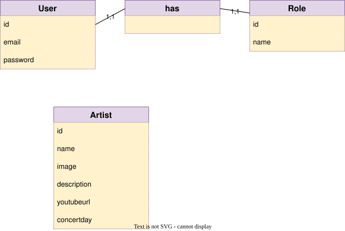
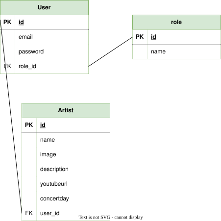
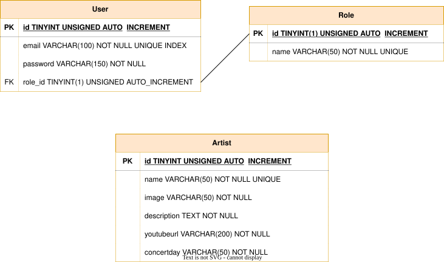

# Solidays App — site événementiel de festival (projet de formation en équipe)

Application web full stack réalisée en **équipe de 3 développeurs** pendant la formation de développeur web et web mobile chez **Simplon.co** : un site dynamique autour d'un festival de musique, avec programmation, fiches artistes, billetterie et back-office.

> Projet pédagogique, sans lien officiel avec le festival Solidays.

## Fonctionnalités

- **Accueil** : hero, rubrique « À la une », présentation du festival.
- **Programmation** : artistes présentés par onglets.
- **Fiches artistes** : contenu chargé dynamiquement depuis l'API.
- **Billetterie** et page « week-end » : informations pratiques sur les billets et le déroulé.
- **Back-office** : gestion des artistes (ajout, modification, suppression) avec upload d'images.
- Mentions légales.

## Stack technique

| Couche | Technologies |
|---|---|
| Front-end | React 19, TypeScript, Vite 7, React Router 7, CSS Modules, React Hook Form |
| Back-end | Node.js, Express 5, TypeScript (tsx) |
| Base de données | MySQL (tables `role`, `user`, `artist`) |
| Fichiers | Upload d'images avec Multer, vérification du type réel du fichier avec `file-type` |
| Qualité | ESLint, Biome |
| Environnement | Docker Compose (MySQL + Node) |

## Architecture

```
code/
├── server/
│   ├── core/          # configuration Express
│   ├── router/        # routes REST (/artist…)
│   ├── controller/    # traitement des requêtes
│   ├── repository/    # accès aux données MySQL
│   └── service/       # connexion MySQL, gestion des fichiers
├── src/
│   ├── pages/         # accueil, programmation, artiste, billetterie, week-end, admin
│   ├── components/    # navbar, hero, bannières, onglets de programmation, footer…
│   └── services/      # appels à l'API
├── merise/            # MCD, MLD, MPD
└── mysql/             # scripts de création et de données de démonstration
```

### Modélisation des données (Merise)

| MCD | MLD | MPD |
|---|---|---|
|  |  |  |

## Travail en équipe

- Développement à trois sur un même dépôt, avec **branches et pull requests** (plus de 50 fusions).
- Répartition des pages et composants entre les membres.

## Lancer le projet en local

Prérequis : Docker et Docker Compose.

```bash
# 0. Créer le fichier d'environnement à partir du modèle
cp code/.env.development.example code/.env.development

# 1. Démarrer MySQL et le conteneur Node
docker compose -f docker-compose.dev.yaml up -d

# 2. Créer la base et insérer les données
docker compose -f docker-compose.dev.yaml exec mysql sh -c "mysql -uroot -proot < solidays.dev.sql && mysql -uroot -proot < fichiers.dev.sql"

# 3. Lancer l'API
docker compose -f docker-compose.dev.yaml exec node sh -c "npm install && npm run server"

# 4. Dans un autre terminal, lancer le front
docker compose -f docker-compose.dev.yaml exec node sh -c "npm run dev -- --host"
```

## Auteur

**Awad Ahmed** — Développeur Full Stack · [LinkedIn](https://www.linkedin.com/in/awad-dev) · [GitHub](https://github.com/AwadRoubahAhmed)
Projet réalisé avec deux camarades de promotion.
